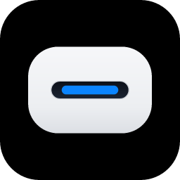
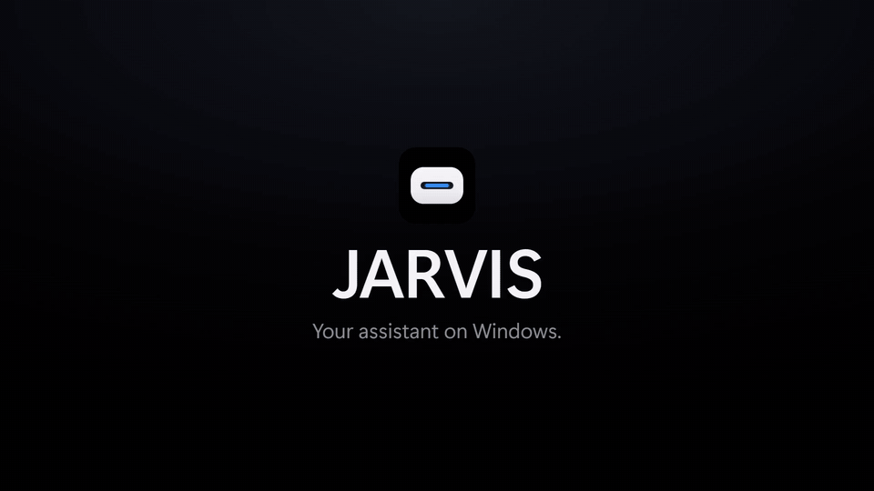
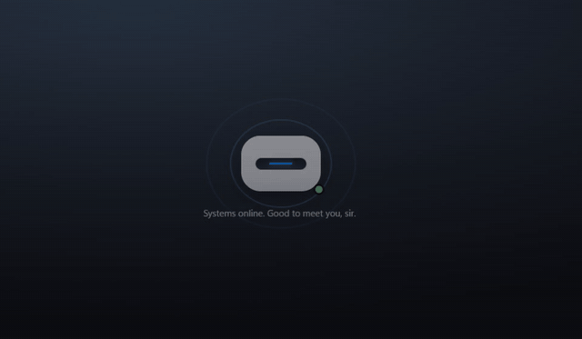
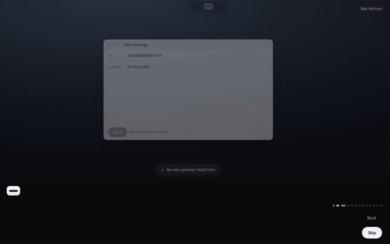
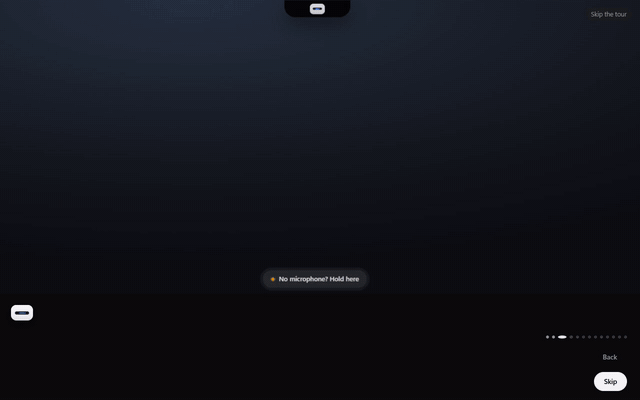
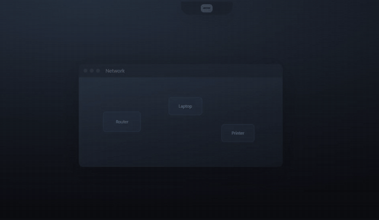
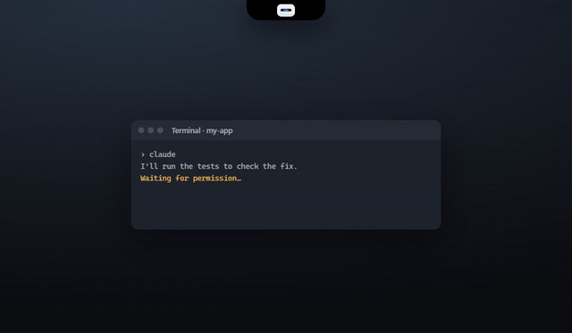
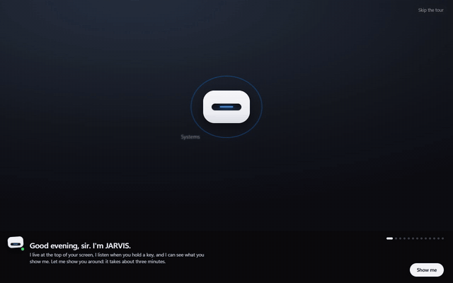

<div align="center">



# JARVIS

**Your assistant at the top of your Windows screen.**<br>
Hold a key and talk: he types for you, answers, points at what you're looking for and keeps your coding agents in check.


<a href="docs/media/readme/jarvis-0.1.0.mp4"></a>

<sub>20 seconds of JARVIS. <a href="docs/media/readme/jarvis-0.1.0.mp4">Watch it with sound</a>.</sub>

**[Download for Windows](https://github.com/Nullzedz/jarvis/releases)** · [Build from source](#build-from-source) · [What's new](windows/src/whats-new/whats-new.json)

</div>

---

## What he does

Every animation below is JARVIS's own tour, recorded as it plays.

<table>
<tr>
<td width="50%" valign="top">

<b>Speak, and he types</b><br>
Hold Right Ctrl in any app, talk, let go. Your words land where your cursor is, without the ums.
</td>
<td width="50%" valign="top">

<b>Talk to him</b><br>
Hold Ctrl + Win and ask anything: your day, your mail, a quick sum, a note to remember. He answers out loud.
</td>
</tr>
<tr>
<td valign="top">

<b>Ask about your screen</b><br>
Press Ctrl + Shift + Z, ask, and he explains what's under your cursor in a card beside it.
</td>
<td valign="top">

<b>Ask where it is</b> <code>BETA</code><br>
"Where's export?" He flies to it, circles it and tells you. For longer trips he guides you step by step, and remembers the way.
</td>
</tr>
<tr>
<td valign="top">

<b>Circle it to show him</b><br>
Hold Ctrl + Shift + Z and draw round anything: a picture, an error, part of a page. Then ask.
</td>
<td valign="top">

<b>The island</b><br>
The black pill at the top of your screen. Hover it: your day, reminders, notes, clipboard, music and focus.
</td>
</tr>
<tr>
<td valign="top">

<b>Your coding agents, kept in check</b><br>
When Claude Code or Codex wants to run something, he asks you first, right in the island: allow, deny or answer.
</td>
<td valign="top">

<b>A tour on day one</b><br>
The first time you open him, a three-minute tour lets you try all of it, then sets up your profile, your AI and your island.
</td>
</tr>
</table>

<details>
<summary><b>Every feature in detail</b></summary>

<br>

**Voice**
- **Dictation anywhere.** Hold Right Ctrl (or any key you choose), speak, let go. Offline with NVIDIA's Parakeet, or Windows' own recognition. A dictionary of names he always spells right, replacements and snippets.
- **Talk to him.** Hold Ctrl + Win and ask. He answers in his own voice.
- **Notetaker.** Record a call without a bot joining it: the transcript, a summary, the key points and the to-dos. Tell the people in the call that you record.

**Your screen**
- **Ask about it.** Ctrl + Shift + Z opens a box where your cursor is; he looks at what's under it and answers beside it.
- **Circle it.** Draw round anything with the keys held, then ask.
- **Where is it?** *(beta)* He reads the app's own buttons, plans the shortest way there and shows you each step: he scrolls, searches and waits for a panel to open. "Show me…" draws the way, "How do I…" tells it. Each route he learns is saved as a note in `Documents\JARVIS Brain`, so asking again costs nothing.

**The island and Home**
- **The island** at the top of your screen: your day, reminders, notes, clipboard, music, focus timer, and the pills you pick.
- **Pills:** GitHub, GitLab, Vercel, n8n, Stripe, Resend, Spotify, Cal.com, Notion, Mail and WhatsApp *(beta)*. Pick up to four in the tour; add their keys in Settings › Connections.
- **Home:** a window with your day at a glance.
- **Mail** with classic Outlook: search, automatic sorting with your rules, banned words and VIPs, with Undo. Nothing is ever deleted.

**Coding agents**
- Claude Code, Codex, Cursor, Gemini CLI, Antigravity, Copilot CLI, OpenCode, Amp, Hermes and any other agent with a hook: every session live in the island, what it reads, edits and runs.
- Approve or deny from the island, answer its questions, read its diffs. If JARVIS isn't running, the hook steps aside: **your agent is never blocked.**

**You**
- **Profile:** your name, what he calls you (sir, ma'am, your name…), a few lines about you, your photo.
- **Passkey:** a code only you know.
- **Your AI:** answer through your Claude, ChatGPT or Gemini plan, signed in with your own account, or with your own API key. Free accounts work, with lower limits.
- **14 languages**, and updates in one click once you agree.

</details>

## Install

Download the installer from the **[latest release](https://github.com/Nullzedz/jarvis/releases)** and run it (Windows 10 or 11).

<details>
<summary><b>Windows shows a warning the first time: that's expected</b></summary>

<br>

The installer isn't code-signed yet, so SmartScreen doesn't know the publisher:

1. A **"Windows protected your PC"** screen appears, with *Publisher: Unknown publisher*.
2. Click **More info**. A **Run anyway** button appears.
3. Click **Run anyway**. The installer starts normally.

JARVIS is open source, and Microsoft Defender scans the installer as clean.

</details>

### Build from source

Requirements: [Rust](https://rustup.rs), Node 20+, the MSVC build tools.

```powershell
git clone https://github.com/Nullzedz/jarvis.git
cd jarvis/windows
npm install
npm run pack                # the installer lands in windows/release/
```

<details>
<summary><b>Setup: keys and agents</b></summary>

<br>

The tour sets up the basics. Everything else is in JARVIS's window, under **Settings**. Keys are kept in Windows Credential Manager, never in a file.

| What | Why | Where |
|---|---|---|
| Claude Code hooks | live sessions and approvals | Settings › Claude Code › **Install hooks**: JARVIS backs up `~/.claude/settings.json` and shows you the change first |
| Other agents | their sessions in the island | Settings › Agents: Codex, Gemini CLI, Antigravity, Cursor, Copilot CLI, OpenCode, Amp, Hermes. Any other: see [`docs/AGENTS.md`](docs/AGENTS.md) |
| Your AI | answers, search, "where is" | Settings › Profile › Your AI: your Claude, ChatGPT or Gemini plan, or an API key |
| Connections | the island's pills | Settings › Connections: each one says what it needs |
| WhatsApp *(beta)* | your chats in the island | Settings › Connections › WhatsApp: an unofficial gateway on your PC, installed in one click |
| Android phone | approvals and chat on your phone | Settings › Android phone, off by default, your local network only: see [`android/README.md`](android/README.md) |

Agents running on a server can reach JARVIS through an SSH tunnel: see [`docs/REMOTE.md`](docs/REMOTE.md).

</details>

<details>
<summary><b>How it works</b></summary>

<br>

- A [Tauri 2](https://tauri.app) app, Rust and TypeScript. The island is a transparent window that stays on top and never steals focus.
- Agent hooks go through a tiny `jarvis-hook.exe` and a named pipe.
- "Where is" reads the app's own buttons through Windows UI Automation, asks the AI once for a route, then follows it by name.
- Your data stays on your PC: `%LOCALAPPDATA%\com.nullzedz.jarvis` and `%APPDATA%\JARVIS`.
- More in [`windows/README.md`](windows/README.md).

</details>

<details>
<summary><b>Other apps in this repository</b></summary>

<br>

The Mac app (`NotchBuddy/`), the iPhone app and JARVIS for Android (`android/`) live here too. JARVIS 0.1.0 is the Windows app; the others will follow it.

</details>

## Contributing

Issues and pull requests are welcome: see [CONTRIBUTING.md](CONTRIBUTING.md).

## Credits

JARVIS by [Nullzedz](https://github.com/Nullzedz), built with Claude Code.

JARVIS stands on the backbone of **[Coucou](https://github.com/Louis-CFM/coucou)** by [Louis Raillé](https://louisraille.fr): the island, the agent hooks and much of the plumbing began there. JARVIS has since gone its own way, with its own design and its own assistant. Thank you, Louis.

JARVIS for Android and the phone link by [Rhytam Biswas (@Rhytam23)](https://github.com/Rhytam23). Thanks to everyone who sent a pull request: see the [contributors](https://github.com/Nullzedz/jarvis/graphs/contributors).

## License

- **Code:** [MIT](LICENSE). Use it, fork it, learn from it; keep the copyright notice. The Android app and the phone link are © Rhytam Biswas, also MIT ([android/LICENSE](android/LICENSE)).
- **Name, character and artwork:** see [LICENSE-ASSETS.md](LICENSE-ASSETS.md).

<div align="center">

**If JARVIS helped, a ⭐ helps a lot.**

</div>
