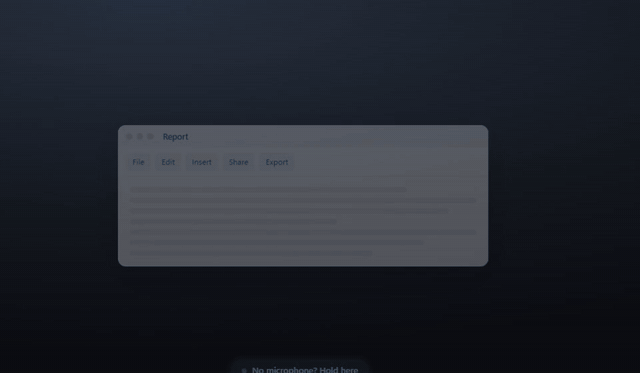
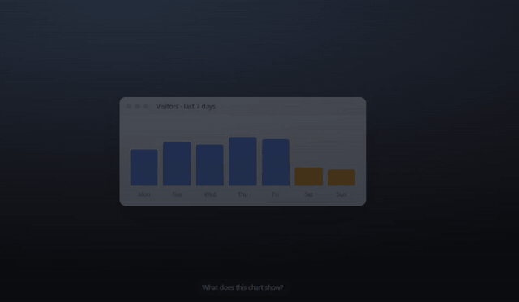

<div align="center">

<br>


# JARVIS

Your assistant at the top of your Windows screen.

<br>

<a href="docs/media/readme/jarvis-0.1.0.mp4"></a>

<br>
<br>

<a href="https://github.com/Nullzedz/jarvis/releases"><b>Download for Windows</b></a>
&nbsp;&nbsp;·&nbsp;&nbsp;
<a href="docs/media/readme/jarvis-0.1.0.mp4">Watch with sound</a>
&nbsp;&nbsp;·&nbsp;&nbsp;
<a href="#build-from-source">Build from source</a>

<br>
<br>

<sub>v0.1.0 &nbsp;·&nbsp; Windows 10 and 11 &nbsp;·&nbsp; MIT</sub>

</div>

<br>
<br>

<br>

<h1 align="center">Speak.</h1>

<p align="center">Hold a key anywhere and talk.</p>

<br>

<p align="center">&nbsp;&nbsp;</p>

<br>

<p align="center"><b>Speak, and he types.</b><br>Hold Right Ctrl in any app, talk, let go. Your words land where your cursor is, without the ums.</p>

<br>

<p align="center"><b>Talk to him.</b><br>Hold Ctrl + Win and ask anything: your day, your mail, a quick sum, a note to remember. He answers out loud.</p>

<br>
<br>

<br>

<h1 align="center">Show.</h1>

<p align="center">Point him at your screen.</p>

<br>

<p align="center">&nbsp;&nbsp;</p>

<br>

<p align="center"><b>Circle it to show him.</b><br>Hold Ctrl + Shift + Z and draw round anything: a picture, an error, part of a page. Then ask about it.</p>

<br>

<p align="center"><b>Ask where it is.</b> <sub><code>BETA</code></sub><br>Ask “where’s export?” and he flies to it, circles it and tells you. On longer trips he guides you step by step, and remembers the way.</p>

<br>
<br>

<br>

<h1 align="center">Delegate.</h1>

<p align="center">Let him keep watch.</p>

<br>

<p align="center">&nbsp;&nbsp;</p>

<br>

<p align="center"><b>The island.</b><br>The black pill at the top of your screen. Hover it for your day, reminders, notes, music and focus.</p>

<br>

<p align="center"><b>Your agents, kept in check.</b><br>When Claude Code or Codex wants to run something, he asks you first, right in the island: allow, deny or answer.</p>

<br>
<br>

<br>
<br>

<h2 align="center">Get JARVIS</h2>

<p align="center">Windows 10 or 11. Free and open source.</p>

<p align="center"><a href="https://github.com/Nullzedz/jarvis/releases"><b>Download the installer</b></a></p>

<p align="center"><sub>The first time, Windows may not know the publisher yet: click <b>More info</b>, then <b>Run anyway</b>.</sub></p>

<br>

<details>
<summary><b>Every feature, in detail</b></summary>

<br>

**Voice**
- **Dictation anywhere.** Hold Right Ctrl (or any key you choose), speak, let go. Offline with NVIDIA's Parakeet, or Windows' own recognition. A dictionary of names he always spells right, replacements and snippets.
- **Talk to him.** Hold Ctrl + Win and ask. He answers in his own voice.
- **Notetaker.** Record a call without a bot joining it: the transcript, a summary, the key points and the to-dos. Tell the people in the call that you record.

**Your screen**
- **Ask about it.** Ctrl + Shift + Z opens a box where your cursor is; he looks at what's under it and answers beside it.
- **Circle it.** Draw round anything with the keys held, then ask.
- **Where is it?** *(beta)* He reads the app's own buttons, plans the shortest way there and shows you each step: he scrolls, searches and waits for a panel to open. "Show me…" draws the way, "How do I…" tells it. Each route he learns is saved as a note in `Documents\JARVIS Brain`, so asking again costs nothing.

**The island and Home**
- **The island** at the top of your screen: your day, reminders, notes, clipboard, music, focus timer, and the pills you pick.
- **Pills:** GitHub, GitLab, Vercel, n8n, Stripe, Resend, Spotify, Cal.com, Notion, Mail and WhatsApp *(beta)*. Pick up to four in the tour; add their keys in Settings › Connections.
- **Home:** a window with your day at a glance.
- **Mail** with classic Outlook: search, automatic sorting with your rules, banned words and VIPs, with Undo. Nothing is ever deleted.

**Coding agents**
- Claude Code, Codex, Cursor, Gemini CLI, Antigravity, Copilot CLI, OpenCode, Amp, Hermes and any other agent with a hook: every session live in the island, what it reads, edits and runs.
- Approve or deny from the island, answer its questions, read its diffs. If JARVIS isn't running, the hook steps aside: **your agent is never blocked.**

**You**
- **Profile:** your name, what he calls you (sir, ma'am, your name…), a few lines about you, your photo.
- **Passkey:** a code only you know.
- **Your AI:** answer through your Claude, ChatGPT or Gemini plan, signed in with your own account, or with your own API key. Free accounts work, with lower limits.
- **14 languages**, and updates in one click once you agree.

</details>

<a id="build-from-source"></a>
<details>
<summary><b>Build from source</b></summary>

<br>

Requirements: [Rust](https://rustup.rs), Node 20+, the MSVC build tools.

```powershell
git clone https://github.com/Nullzedz/jarvis.git
cd jarvis/windows
npm install
npm run pack                # the installer lands in windows/release/
```

</details>

<details>
<summary><b>Setup: keys and agents</b></summary>

<br>

The tour sets up the basics. Everything else is in JARVIS's window, under **Settings**. Keys are kept in Windows Credential Manager, never in a file.

| What | Why | Where |
|---|---|---|
| Claude Code hooks | live sessions and approvals | Settings › Claude Code › **Install hooks**: JARVIS backs up `~/.claude/settings.json` and shows you the change first |
| Other agents | their sessions in the island | Settings › Agents: Codex, Gemini CLI, Antigravity, Cursor, Copilot CLI, OpenCode, Amp, Hermes. Any other: see [`docs/AGENTS.md`](docs/AGENTS.md) |
| Your AI | answers, search, "where is" | Settings › Profile › Your AI: your Claude, ChatGPT or Gemini plan, or an API key |
| Connections | the island's pills | Settings › Connections: each one says what it needs |
| WhatsApp *(beta)* | your chats in the island | Settings › Connections › WhatsApp: an unofficial gateway on your PC, installed in one click |
| Android phone | approvals and chat on your phone | Settings › Android phone, off by default, your local network only: see [`android/README.md`](android/README.md) |

Agents running on a server can reach JARVIS through an SSH tunnel: see [`docs/REMOTE.md`](docs/REMOTE.md).

</details>

<details>
<summary><b>How it works</b></summary>

<br>

- A [Tauri 2](https://tauri.app) app, Rust and TypeScript. The island is a transparent window that stays on top and never steals focus.
- Agent hooks go through a tiny `jarvis-hook.exe` and a named pipe.
- "Where is" reads the app's own buttons through Windows UI Automation, asks the AI once for a route, then follows it by name.
- Your data stays on your PC: `%LOCALAPPDATA%\com.nullzedz.jarvis` and `%APPDATA%\JARVIS`.
- More in [`windows/README.md`](windows/README.md).

</details>

<details>
<summary><b>Other apps in this repository</b></summary>

<br>

The Mac app (`NotchBuddy/`), the iPhone app and JARVIS for Android (`android/`) live here too. JARVIS 0.1.0 is the Windows app; the others will follow it.

</details>

<br>
<br>

<h2 align="center">Thanks</h2>

<p align="center">JARVIS stands on the backbone of <a href="https://github.com/Louis-CFM/coucou"><b>Coucou</b></a> by <a href="https://louisraille.fr">Louis Raillé</a>.<br>It has since gone its own way, with its own design and its own assistant.</p>

<p align="center">JARVIS for Android and the phone link by <a href="https://github.com/Rhytam23">Rhytam Biswas</a>.<br>And thanks to every <a href="https://github.com/Nullzedz/jarvis/graphs/contributors">contributor</a>.</p>

<br>

<p align="center"><sub>Made by <a href="https://github.com/Nullzedz">Nullzedz</a> with Claude Code &nbsp;·&nbsp; <a href="LICENSE">MIT</a> &nbsp;·&nbsp; <a href="LICENSE-ASSETS.md">Name and artwork</a> &nbsp;·&nbsp; <a href="CONTRIBUTING.md">Contributing</a></sub></p>

<br>
